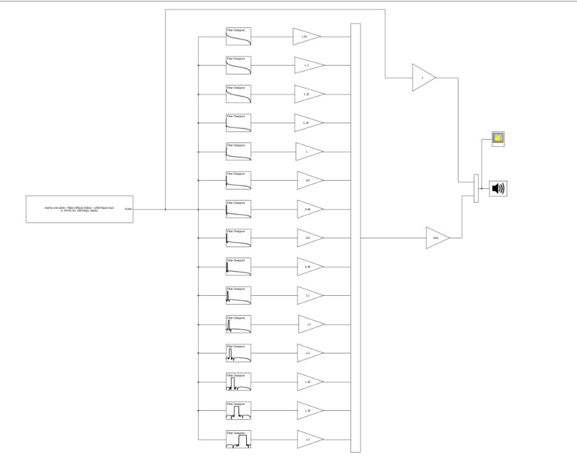
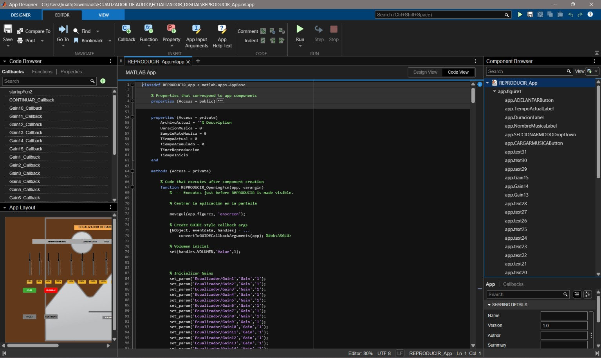
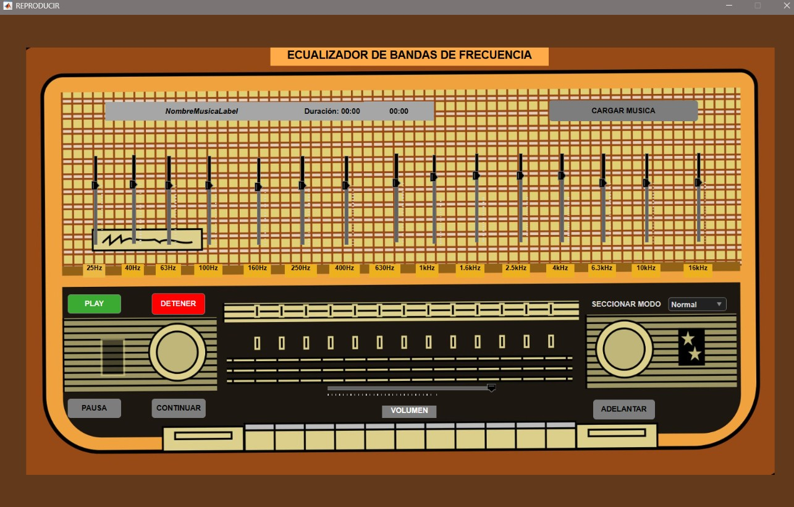
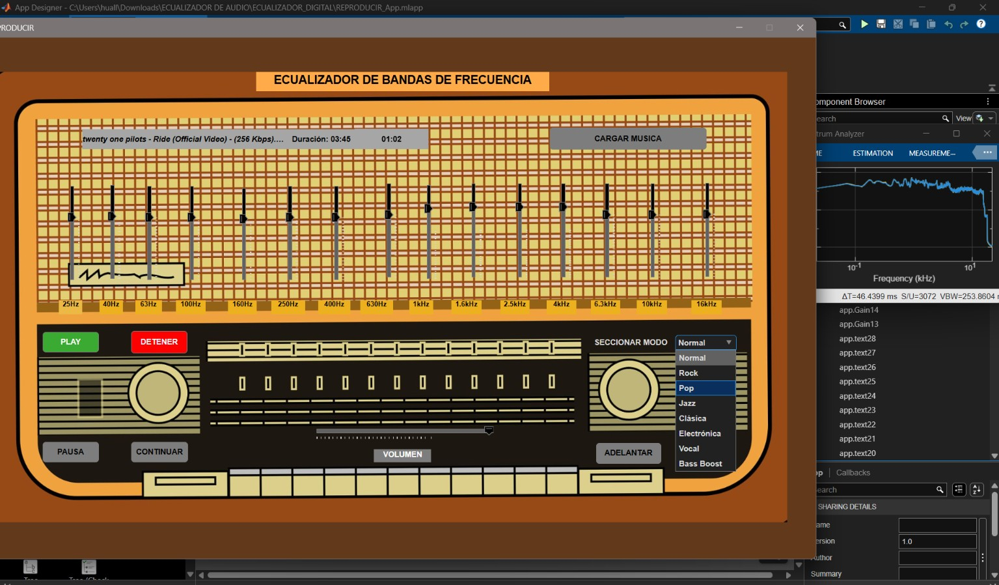

# Ecualizador Digital de Audio con MATLAB, Simulink y App Designer

## Descripción

Este proyecto consiste en el diseño e implementación de un **ecualizador digital de audio** utilizando **MATLAB y Simulink**.

El sistema emplea un conjunto de **filtros digitales IIR (Infinite Impulse Response)** para dividir y procesar diferentes bandas de frecuencia de una señal de audio. Cada banda cuenta con un control de ganancia que permite aumentar o disminuir su contribución en la señal de salida.

El procesamiento principal del audio se realiza mediante un modelo desarrollado en **Simulink**, utilizando bloques para la entrada, filtrado, control de ganancias, multiplexación y reproducción del audio.

Para facilitar la interacción con el sistema, se realizó la integración de **Simulink con MATLAB App Designer**, desarrollando una interfaz gráfica desde la cual es posible controlar las ganancias de las **15 bandas de frecuencia** de una manera más directa e intuitiva.

---

## Objetivo del proyecto

Diseñar e implementar un sistema de ecualización digital de audio que permita modificar diferentes regiones del espectro de una señal mediante filtros IIR y proporcionar al usuario una interfaz gráfica para controlar de manera sencilla las ganancias de las diferentes bandas de frecuencia.

### Objetivos específicos

- Diseñar un ecualizador digital utilizando filtros IIR.
- Procesar una señal de audio mediante Simulink.
- Dividir el contenido de la señal en diferentes bandas de frecuencia.
- Implementar el control individual de la ganancia de las 15 bandas.
- Utilizar un archivo multimedia como fuente de audio.
- Combinar las señales provenientes de las diferentes bandas.
- Reproducir la señal de audio procesada.
- Diseñar una interfaz gráfica mediante MATLAB App Designer.
- Integrar la interfaz de App Designer con el modelo desarrollado en Simulink.
- Facilitar el control del ecualizador mediante una interfaz más directa e intuitiva.

---

## Fundamento del proyecto

Un ecualizador permite modificar la amplitud de diferentes regiones de frecuencia de una señal de audio.

En este proyecto, la señal de entrada es procesada mediante diferentes filtros IIR, donde cada filtro representa una banda de frecuencia del ecualizador.

---

## Procesamiento de la señal de audio

El audio utilizado como entrada al sistema es proporcionado mediante el bloque:

    From Multimedia File

Este bloque permite ingresar un archivo multimedia al modelo de Simulink para realizar el procesamiento de la señal.

Posteriormente, la señal es distribuida hacia el conjunto de filtros IIR correspondientes a las diferentes bandas del ecualizador.

Cada banda es procesada de manera independiente y posteriormente se aplican las ganancias correspondientes.

Finalmente, las señales procesadas son combinadas para obtener la señal de audio ecualizada, que es enviada al bloque:

    Audio Device Writer

permitiendo escuchar directamente el resultado del procesamiento.

---

## Ecualización mediante 15 bandas

El ecualizador cuenta con **15 bandas de frecuencia**, cada una con un control de ganancia independiente.

El usuario puede modificar las ganancias de las diferentes bandas para aumentar o reducir determinadas regiones del espectro de audio.

De manera conceptual:

  

El ajuste de las ganancias permite modificar la respuesta del ecualizador de acuerdo con la configuración seleccionada por el usuario.

---

## Integración de Simulink con App Designer

Una de las principales características del proyecto es la integración entre **Simulink y MATLAB App Designer**.

El procesamiento digital de la señal se encuentra implementado en Simulink, mientras que App Designer se utiliza como interfaz de control.

En lugar de modificar directamente los parámetros de cada bloque dentro del modelo de Simulink, la aplicación proporciona controles que permiten modificar las ganancias de las 15 bandas desde una interfaz gráfica.

Esta integración permite separar la parte de **procesamiento de señales** de la parte de **interacción con el usuario**.

  

---

## Interfaz gráfica

La interfaz fue desarrollada utilizando **MATLAB App Designer**.

Su objetivo principal es facilitar el control del ecualizador y proporcionar una experiencia de interacción más sencilla que la modificación directa de los parámetros del modelo de Simulink.

La interfaz permite controlar las ganancias correspondientes a las 15 bandas de frecuencia.

Entre sus funciones se encuentran:

- Control de las 15 bandas del ecualizador.
- Ajuste individual de las ganancias.
- Interacción con el modelo de Simulink.
- Control de los parámetros del ecualizador desde una interfaz gráfica.
- Ingreso y reproducción de audio.
- Escucha del resultado del procesamiento.

La interfaz busca que el usuario pueda realizar la ecualización de una manera más **directa, intuitiva y sencilla**.

  

---

## Componentes principales

### MATLAB

MATLAB se utiliza como plataforma principal para el desarrollo del proyecto y para la creación de la aplicación mediante App Designer.

### Simulink

Simulink contiene el modelo encargado del procesamiento de la señal de audio.

En el modelo se utilizan bloques destinados a:

- Entrada de audio.
- Filtrado digital.
- Control de ganancias.
- Multiplexación y combinación de señales.
- Reproducción del audio.

### Filtros IIR

Los filtros IIR son utilizados para realizar la separación y procesamiento de las diferentes bandas de frecuencia.

Cada filtro permite trabajar sobre una región determinada del espectro de la señal.

### From Multimedia File

Este bloque permite introducir el archivo de audio al modelo de Simulink.

### Multiplexación y combinación

Las diferentes señales provenientes del procesamiento de las bandas son organizadas y combinadas para obtener la señal final del ecualizador.

### Audio Device Writer

El bloque permite reproducir la señal resultante y escuchar el efecto producido por la configuración del ecualizador.

### MATLAB App Designer

App Designer se utiliza para desarrollar la interfaz gráfica encargada de controlar los parámetros del modelo de Simulink.

---

## Flujo general del sistema

El funcionamiento general del proyecto puede resumirse en las siguientes etapas:

1. El usuario proporciona un archivo de audio.
2. El archivo es ingresado al modelo mediante `From Multimedia File`.
3. La señal de audio es procesada por el banco de filtros IIR.
4. La señal se divide en diferentes bandas de frecuencia.
5. Cada banda recibe una ganancia determinada.
6. Las señales procesadas son combinadas.
7. Se obtiene la señal de audio ecualizada.
8. La señal resultante es enviada al `Speaker`.
9. El usuario puede modificar las ganancias mediante la interfaz desarrollada en App Designer.
10. Los cambios realizados desde la interfaz permiten controlar el comportamiento del ecualizador en Simulink.

---

## Tecnologías utilizadas

- **MATLAB**
- **Simulink**
- **MATLAB App Designer**
- **Procesamiento Digital de Señales (DSP)**
- **Filtros digitales IIR**
- **Procesamiento digital de audio**

---

Los nombres de los archivos pueden modificarse de acuerdo con los nombres reales utilizados en el proyecto.

---

## Ejecución del proyecto

### Requisitos

Para ejecutar el proyecto se requiere:

- MATLAB.
- Simulink.
- MATLAB App Designer.
- Las herramientas o bloques de procesamiento multimedia requeridos por el modelo.

### Procedimiento

1. Descargar o clonar este repositorio.

2. Abrir MATLAB.

3. Establecer como directorio de trabajo la carpeta principal del proyecto.

4. Abrir el modelo de Simulink.

5. Abrir la aplicación desarrollada con App Designer.

6. Seleccionar o proporcionar un archivo de audio compatible.

7. Ejecutar el modelo de Simulink.

8. Utilizar la interfaz gráfica para modificar las ganancias de las 15 bandas.

9. Escuchar el audio procesado mediante el Speaker.

---

## Resultados

El sistema permite modificar el contenido espectral de una señal de audio mediante el ajuste de las ganancias de las 15 bandas del ecualizador.

La integración entre Simulink y App Designer permite realizar este ajuste desde una interfaz gráfica, haciendo que el control de los parámetros sea más directo que la modificación manual de los bloques del modelo.
  

## Conceptos aplicados

Durante el desarrollo del proyecto se aplicaron conceptos relacionados con:

- Procesamiento Digital de Señales.
- Procesamiento digital de audio.
- Filtros digitales.
- Filtros IIR.
- Análisis de señales.
- Bandas de frecuencia.
- Control de ganancia.
- Simulink.
- MATLAB.
- MATLAB App Designer.
- Integración entre una aplicación gráfica y un modelo de Simulink.
- Procesamiento y reproducción de señales de audio.

---

## Contexto académico

Este proyecto fue desarrollado como parte del aprendizaje y aplicación de conocimientos de **Ingeniería Electrónica**, particularmente en el área de **Procesamiento Digital de Señales**.

El proyecto integra conceptos teóricos de procesamiento de señales con herramientas de simulación y desarrollo de interfaces gráficas, permitiendo aplicar estos conocimientos en un sistema funcional de procesamiento de audio.

Este proyecto se publica con fines académicos y de portafolio.

---

## Autor

**Erick Huallanca**

**Autor:** Erick Isaias Huallanca Perez  
**Contacto:** [LinkedIn](https://www.linkedin.com/in/erick-isaias-huallanca-perez-925b7632b) | [huallanca999s@gmail.com](mailto:huallanca999s@gmail.com)

